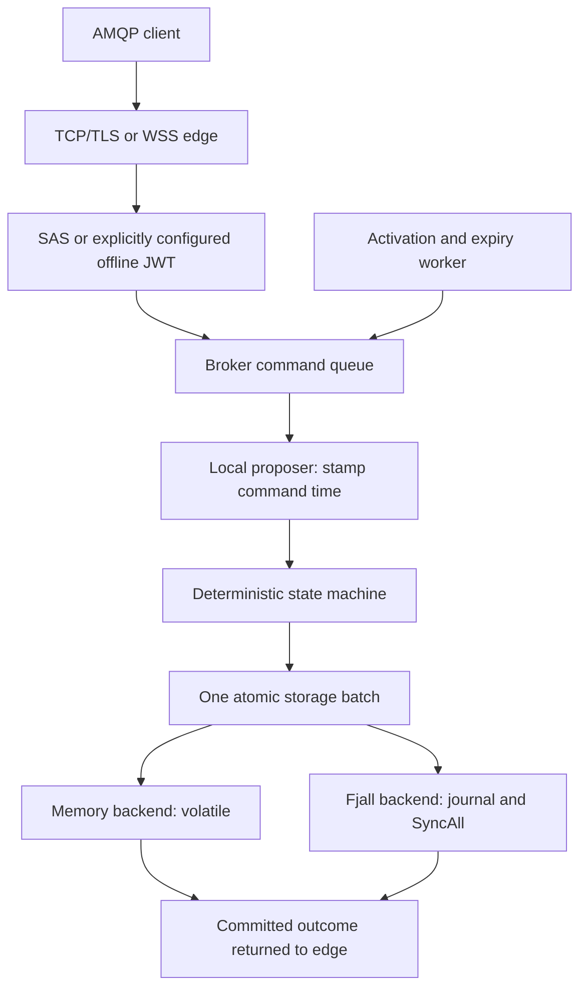
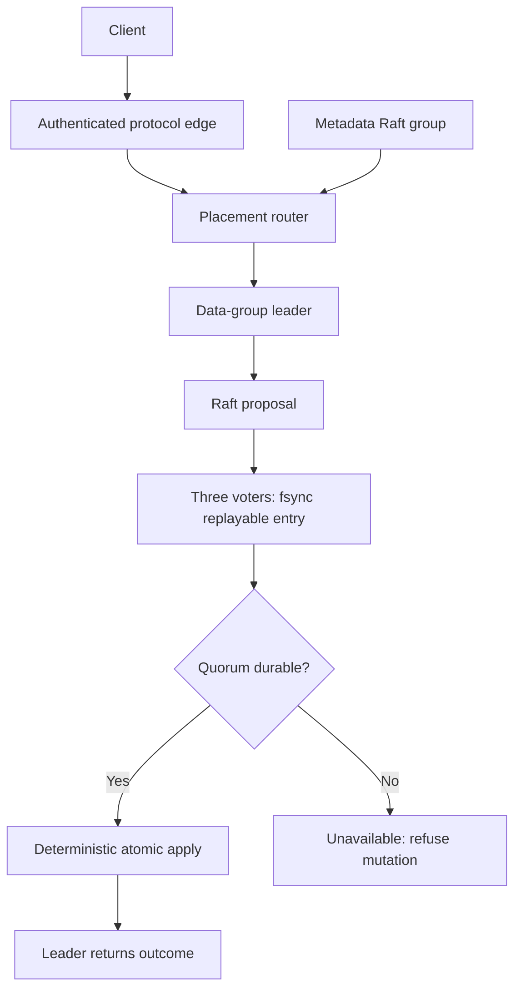

# Switchyard Architecture

## Current Runtime

Switchyard is pre-alpha and single-node. One namespace reaches the deterministic
state machine through the repository-owned AMQP engine and local proposer. Fjall
survives restart; memory does not. Neither survives loss of its only node.
Configured voters validate startup policy but do not start Raft or establish quorum.

The edge accepts only after apply succeeds; durable acknowledgement requires
Fjall. Commands carry timestamps; rejection writes nothing. See
[server](crates/server/src/lib.rs),
[proposer](crates/server/src/proposer.rs), and
[state machine](crates/domain/src/machine.rs).

### Protocol And Identity

The edge owns framing, links, credit/drain, settlement, SASL, and Service Bus
entity/annotation/`$management` mappings. SASL PLAIN or ANONYMOUS/`MSSBCBS` then
CBS SAS provides Send/Listen/Manage authorization. Explicitly configured offline
RS256 JWT CBS is also available after actual TLS admission, alone or alongside
SAS. Expired grants close links;
initial authorization has a deadline. TLS precedes AMQP; WSS carries binary
AMQP at `/$servicebus/websocket`.

Accepted native connections retain their original driver and reader handles.
Sticky stop bypasses bounded commands and interrupts driver IO/channel waits
before normal link cleanup. `shutdown` joins both and caches results across
canceled waiters; Drop requests stop without joining. Joined shutdown is not a
peer Close acknowledgement. Sender-capacity waits observe Detach and command
closure. An optional per-listener socket limit counts handshakes and open
connections until their original task joins. One monotonic admission deadline
per accepted socket (60 s by default) spans TLS, WebSocket upgrade, SASL and
Open without resetting per stage; the native accept takes the remaining
deadline. Expiry drops the handshake, closing the socket, and the original task
returns `TimedOut` before Open, so no broker work has begun. The listener retains
its original accepted connection family through actual joins, including canceled
serve/finish borrowers and panicked originals.
See [native custody](crates/amqp/src/server/tasks.rs).

Incoming session frame grants are independent of bounded message storage.
Native assembly reserves the effective link ceiling before accepting a start;
completed handoffs retain an encoded-byte/count reservation and their final
frame slot until actual dequeue. Original queue/storage ownership survives
retirement without refunding a replacement session. Receive handoffs never wait
inside frame dispatch. See [receive limits](docs/compatibility.md#native-session-receive-capacity).

### Process Shutdown

SIGTERM and SIGINT start one [shutdown sequence](crates/server/src/shutdown.rs);
later signals join it. Stages run strictly in order: retire all configured AMQP,
native administration and Atom admissions before any drain,
finish protocol cleanup (join original connection, session, link and settlement
tasks and accepted administration work), stop and join the timer, then stop the broker owner after the requests
queued ahead of it, which drops the state machine and closes the store. The
broker outlives every stage that can submit, so begun work commits and answers
its caller. Stopping the broker empties the one request sender all handles
share, so later requests fail with `BrokerStopped` and a request queued behind
the stop is freed with its waiter instead of being held by surviving handles.
One budget (`--shutdown-timeout-secs`, default 30) spans all stages. On expiry
the process logs the unfinished stage and exits with status 3 without waiting;
nothing is settled on the way out, and only committed work was acknowledged. A
startup that fails after the timer and broker start (such as an occupied listen
address) stops them under the same budget and keeps its own error and status 1.

Namespace, queue, topic, and subscription names are ASCII case-insensitive in
typed identifiers, storage, AMQP addresses, and entity-scoped SAS audiences.
Session and placement identifiers remain case-preserving.

### Administration And Identity Libraries

The opt-in native TLS/HTTP/2 EntityService exposes queue, topic and explicit
subscription Create/Get/List through the same bounded broker owner. Each RPC
requires a current offline JWT with namespace-root Manage before backend dispatch;
entity-only Manage is insufficient. The native CLI uses verified HTTPS, supplied
CA/token files and bounded opaque continuation handling. Update/Delete, rule and
capacity mutation, placement and runtime counters remain outside that surface.
See [native administration](crates/server/README.md) and
[CLI](crates/switchyardctl/README.md).

Atom has a separate opt-in TLS/HTTP/1 listener with namespace/entity Manage checks,
bounded admission, messages and deadlines, and one request per connection. Accepted
handler originals survive client disconnect or wire deadlines until actual join.
Shipped routes remain closed: definition singletons return 501 and unsupported or
ambiguous profiles refuse. No XML/CRUD/rule adapter or administration-client
certification follows merely from this transport.

The [OIDC library](docs/offline-jwt.md#bounded-discovery-library)
supports explicit HTTPS discovery/key refresh with exact issuer/JWKS URL and public
dial-IP pins, no DNS tasks or token-triggered fetch, and shared bounded freshness.
It preserves the narrow local JWT profile; the server still uses offline policy
files. The optional [workload TLS foundation](docs/workload-identity.md) verifies
client certificates and provides endpoint-bound scoped authority with a fixed
lease. AMQP/admin consumption and restart activation are not yet connected.
Transactions and production activation also remain separate work.

### Message State

| Implemented area | Contract |
| --- | --- |
| Peek-lock | Lock commits before delivery; completion commits deletion. At-least-once delivery. |
| Receive-delete | Deletion commits before transfer. At-most-once delivery. |
| Atomic batches | Every child validates before one commit; failure consumes no sequence or history. |
| Sessions | Exclusive session lock and durable opaque state; FIFO only within a session. |
| Scheduling | Topic/queue placeholder is browseable but not receivable; activation assigns an active sequence and starts TTL. |
| Deferral and peek | Deferred records require explicit retrieval; peek is read-only and sequence-ordered. |
| Duplicate detection | Ordinary queue/topic-scoped exact non-empty message IDs suppress copies for a deterministic history window. |
| Topics | Publication and matching subscription copies commit atomically; subscriptions use the queue lifecycle. |
| DLQ | A reserved queue drained by ordinary receive/settlement; no cascading dead-lettering. |

Immediate topic publication evaluates subscriptions and rules at command apply.
Scheduled publication stores only a topic-owned placeholder: subscriptions and
rules are evaluated at later activation, not send time. Each subscription starts
with `$Default`; actionless true/false/correlation/SQL rules use OR across rules and
typed AND within a correlation filter. Multiple actionless matches produce one copy.
Each matching action rule adds an isolated copy with a copy-local SET/removal
overlay and an additional parent sequence slot. All filters inspect original
input; complete bounded copy/sequence planning precedes writes. Exact action
source uses rule V3/proposal V10, and deletion-bearing copies use message V4;
see [SQL actions](docs/sql-actions.md) for bounds and failure policy. A
publication with no matches succeeds without retaining an active copy. Payloads
are copied per subscription; shared payload storage is not implemented.

Routing proves the complete listed subscription set, including exact canonical
membership bytes, parent-derived backing configuration, and the real DLQ
profile, before exposing a page or committing copies. A 2,001-entry lookahead
enforces the 2,000-subscription cap. Present configurations and listed profiles
require private live owner heads; DLQs share their owner's head. Bound broker
calls retain an opaque owner/target identity and recheck it before host or stored
Clock, including configuration-free commands. AMQP data senders retain that
binding from authorized attach for ordinary/batch/scheduled transfers; management
request links retain a separate capture for Peek, scheduling/cancellation and rule
operations. Neither recaptures after a refusal. Ordinary receiving links also capture once at attach:
polls, both receive modes, staged deletion and delayed settlements retain it.
Ordinary delivery capabilities preserve this provenance for management settlement
and renewal after selection, independently of registry lifetime. Deferred locks
retain receive-time authority, while session state and renewal consume the selected
original session registration and hold. Session acceptance and release also retain
original entity authority. This fences owner incarnations, not the remaining
held-session-grant semantics. Legacy name APIs, timers, native APIs and raw
catalog/diagnostic reads are outside the declared AMQP fencing surface. No global
orphan scan is added.
See [topic routing](crates/domain/src/machine/topic.rs) and the
[compatibility differences](docs/compatibility.md#known-differences-and-bounds).

### Time And Storage

The timer proposes bounded activation and lock, TTL, session-lock, and duplicate
sweeps. Independent cursors isolate entity failures; saturated scans continue
immediately. The proposer holds time still for small host-clock regressions and
refuses larger ones, logged/retried but not wired to readiness. The state machine
rejects regressing command time.

The [storage contract](crates/storage/src/lib.rs) provides atomic memory/Fjall
batches. [Fjall opening](crates/storage/src/durable.rs) accepts format 3. It refuses
formats 1 and 2 or a missing marker with any known-keyspace row; empty known stores
may be stamped. Only the explicit offline
[store upgrade](crates/cluster/src/store_upgrade.rs) (`switchyardctl store upgrade`)
moves format 2 to 3, after the domain's bounded
[legacy-content preflight](crates/domain/src/legacy_content.rs).
A directory has one live owner. Domain keys are big-endian with explicitly
versioned values;
ordinary opening does not validate foreign keyspaces.

The opt-in [journal](crates/cluster/src/journal.rs) reserves `0xF0` for opaque
entries and commitment. The [proposal codec](crates/domain/src/durable_proposal.rs)
retains intent, time and authority, not authentication.
[Indexed apply](crates/domain/src/indexed.rs) checkpoints domain effects under
`0xF1`; [committed replay](crates/cluster/src/replay.rs) validates committed
proposals and uses their original time/authority through a captured frontier.
Callers must serialize all relevant cloned/raw and unindexed writers; `&mut self`
is not CAS.

The [snapshot format](crates/cluster/src/snapshot/format.rs) checks framing,
ordered records, declared frontiers and a digest, not domain/journal health.
Layout 3 frames carry format 3 records; capture checks their retained AMQP content
against the fixed profile, and layout 2 frames refuse. Typed-content admission
validates newly accepted writes as well. Upgrade/capture still validate existing
records; a format marker alone is not content or full-state health proof.
[Fjall provenance](crates/storage/src/durable.rs) checks keyspace inventory and
original handle identity, then reads metadata and records through one snapshot.
Callers must exclude all writers and keyspace creation, deletion and configuration
changes; it is not authentication or a read-only directory opener.

The pure [retained-byte kernel](docs/retained-byte-accounting.md) measures exact
message/index KV lengths and prepaid automatic-growth reservations. It has no
live conservation or admission integration. Historical finite V3/V7 metadata
stays metadata-only. New generation-bound profile V4, isolated `0x13` retained keys
and bounded capacity intent V11 are inert framing: ordinary writers, proposer
timestamp selection, replay, snapshots and upgrades refuse unsupported ownership
before effects. Message V4 accounting remains unsupported. See
[capacity fences](docs/capacity-writer-fences.md).

Production startup remains refused. These libraries do not activate runtime
replay, quorum, full-state recovery, installation or compaction. Encryption and
live quota enforcement remain planned; see [compatibility](docs/compatibility.md).

Separate opt-in [consensus persistence](docs/consensus-persistence.md) pins a Raft
core and stores fixed-three identity, term/vote/log/commit under `0xF2` in isolated
storage profile 4. Ordinary storage remains profile 3. This local foundation does
not run the core's election/transport driver or establish quorum; its exclusive
backends cannot be used as unindexed domain writers or legacy snapshot targets.

## Production Target: Not Implemented

The intended release is a Rust-native Linux broker with quorum durability,
multi-tenant isolation, and Standard-compatible queues/topics. The design below
is a requirement for future work, not an available deployment configuration.
The server runtime, storage, and TLS must avoid RocksDB, OpenSSL, and system TLS.

### Placement And Durability

- At least three odd-numbered cluster voters; three replicas per placement group.
- A queue has one group by default. A topic, its subscriptions, and rules share
  one group so fanout is atomic.
- Immutable explicit placement permits same-group transactions. Partitioned
  entities and cross-group transactions are outside the first release.
- Metadata owns membership, namespace policy/quotas, placement, compatibility,
  and backup/audit configuration, never message bodies.
- Edge connections and AMQP link state remain local; messages, locks, sessions,
  and settlements become replicated state.
- Acknowledgement requires a quorum-fsynced replayable entry plus leader apply.
  Without quorum, mutations, lock-acquiring receives, and consistent management
  reads refuse with retryable availability errors.
- Moves require learner snapshot/catch-up, joint-consensus promotion, then
  removal. Applied indexes/snapshots fence log compaction.

Transactions stage invisible operations and commit in one same-group batch;
disconnect/lease expiry aborts them. Cross-group forwarding instead needs a
durable source outbox, idempotent destination command, and completion marker:
at-least-once forwarding, not distributed atomicity.

### Isolation, Security, And Recovery

Namespaces will be mutually untrusted. Bounded storage leases, rate allocations,
and weighted scheduling must enforce quotas/fairness; limits refuse sends,
never evict live messages.

OIDC and mTLS/SPIFFE mappings will supplement SAS. Per-namespace AES-256-GCM keys
will protect bodies, properties, session state, credentials, and sensitive IDs;
keyed digests protect equality indexes. Routing/sequencing may remain plaintext.
External KMS must retain wrapped versions for reads, rotation, backup, and restore.

Audit will exclude sensitive content, form per-group hash chains, and export
signed batches to configured WORM storage/telemetry. Compliance mode will require
TLS, external KMS, complete auditing, encrypted backups, and fail-closed bounded
audit backlog. Every authentication decision, admin change, message operation,
backup, restore, and export must be audited. These are planned controls, not certification. See
[threat model](docs/threat-model.md).

Encrypted snapshots and immutable committed-log archives will support
point-in-time restore into an empty cluster. Signed manifests must pin metadata,
membership, applied indexes, checksums, and key versions, verified before
installation. Quorum, disk, clock, KMS, audit backlog, and backup freshness will
feed readiness/alerts. Exporters remain operator-configured.

## Completion Gates

The [roadmap](docs/roadmap.md) owns issue status and dependencies. The release
contract remains unfulfilled until these independent gates pass:

- [ ] Current/previous pinned .NET and pinned Sift data/administration gates;
  differential checks for supported behavior, not blanket compatibility claims
- [ ] Crash/fsync/snapshot recovery and partition/leader-change replay tests
- [ ] Authorization, hard quotas/fairness, KMS outage/rotation, and audit integrity
- [ ] Corrupt-backup refusal, empty-cluster restore, and rolling-upgrade checks
- [ ] Parser fuzzing, model/property tests, and protocol/configuration golden vectors
- [ ] Signed Linux x86_64/arm64 binaries/images, SBOMs, and deployment guidance
- [ ] Published reference-hardware evidence: 5 TiB retained-data compaction,
  failover, backup, and restore soak; 100,000 aggregate durable 1 KiB messages/s,
  three replicas, encryption/audit,
  NVMe/10 GbE, and send acknowledgement below 20 ms p99

Version 1.0 is reserved for passing compatibility, durability, security, recovery,
and performance gates. Premium features, cross-region replication, a browser
dashboard, a Kubernetes operator, and non-Linux production servers are not
initial release commitments.
