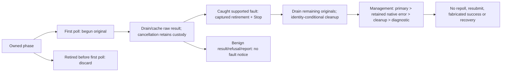

# Lifecycle Contracts

This is the detailed contract reference for the [compatibility index](compatibility.md).
It describes single-node `main`, not recovery, whole-task-tree or production guarantees.

## Atomicity And Lifecycle

Commands carry time and commit one batch. Rejection changes no messages, counters,
history or Clock; validation precedes allocation/history mutation. Session batches
share one session. Deduplication suppresses sends, not lock redelivery.

Opt-in indexed apply atomically commits effects/Clock/checkpoint. Both it and the
opt-in journal retire before storage apply; only success and cache updates restore
usability. Returned storage-apply errors or explicitly caught storage-apply unwinds
require reopen. With external exclusive writes, journal reopen reads append
presence/commit frontier; indexed reopen exposes an unapplied index or outcome-free
latest duplicate. Neither recovers a panic or provides quorum/power-cut guarantees.

Validated exactly-full rule/subscription creation can checkpoint a capacity refusal
without changing domain effects or Clock (#168). Selected corrupt/overfull reader
failures and unmarked cap errors remain fatal; this is not global catalogue health.

Opt-in same-store replay (#160) validates committed schemas before effects and
preserves recorded time/authority. Its frontier is captured at open; tail payloads
remain opaque under structural validation. Fatal batch errors/unwinds retire the
owner until reopen. No refresh, outcomes, startup wiring or quorum is provided.

The snapshot format defines caller-capped canonical raw records, declared
frontiers and a byte digest; decoding alone does not establish domain/F0/F1
health, backend provenance or authenticity. Opt-in offline `SnapshotCapture`
takes one immutable storage image, validates complete domain state and every
F0/F1 row on that same image, and encodes those exact records without applying,
sweeping or repairing anything. It validates current P <= C <= L, all retained
committed proposal schemas (including applied history) and the indexed proposal
digest at P. In unanchored images every entry from 1 is retained.
Structurally valid uncommitted payloads remain opaque. Missing F1 is accepted
only without any domain rows, including Clock; a valid nonzero checkpoint may
accompany an empty domain after an indexed refusal. Foreign F0 namespaces refuse
capture without changing ordinary journal-open namespace policy.

The caller must exclude every writer, including raw/cloned stores and all
keyspace/topology handles, for the complete capture call. The APIs do not enforce
this precondition or activate online capture. Logical capture preserves only
logical provenance; the explicit Fjall entry point uses the existing metadata
bridge. Typed provenance stays beside the result because the SWSS frame does not
encode it. Capture failures propagate without retries or source writes, under
the storage bridge's exclusivity contract. After the backend read, shared frame
preflight checks record/key/value/exact encoded-size caps and canonical order
before domain/owner decoding. Raw F1 presence selects only a provisional identity
header width, not ownership or authority; encoding rechecks the verified manifest.
The full read and validation allocate O(image bytes); caps do not bound backend
snapshot allocation or semantic container overhead. Capture is not authentication,
historical authority, an installation certificate or recovery.

Offline `SnapshotInstallOwner` accepts only that typed capture, with records,
manifest and source evidence still bound together. It inspects one immutable
target image and validates the complete old domain/F0/F1 state on that same
image before preparing replacement. Empty valid targets are eligible; populated
unindexed or corrupt targets refuse rather than being repaired. Source and target
provenance classes must match by default; cross-backend installation requires an
explicit opt-in. Source evidence stays distinct from target evidence. A logical
source does not acquire native source provenance by being installed into Fjall.
Trust, authentication and historical authority remain caller responsibilities;
an earlier valid applied frontier is not forbidden by an anti-rollback check.

The non-Clone storage owner requires caller-enforced exclusion of every writer,
raw clone, topology/keyspace mutator and preexisting domain/journal/indexed/replay
owner for the complete operation. Fjall always inspects the original native
handles, exact inventory and current marker, with no logical fallback. Target
metadata is preserved byte-for-byte; no marker migration or rewrite is performed.
After snapshot materialization, incoming and old record/key/value caps, combined
delete-plus-put count and logical mutation bytes are checked before batch
allocation. Overlapping keys count twice; mutation bytes count old deletion keys
plus incoming keys and values. Native nonempty/u16 key, u32 value and combined
u32 mutation-count bounds also apply. These are not backend snapshot-allocation,
allocator-overhead or physical disk-space guarantees.

A target-bound single-use preparation deletes all old logical records, then puts
all incoming records in one atomic apply. Clock, checkpoint, committed frontier
and opaque uncommitted tails remain byte-exact; no replay or promotion occurs.
The owner retires immediately before external apply and restores usability only
on success with its prebuilt result. A returned apply error or escaping original
panic leaves all I/O and release APIs unusable until all handles close and the
store is reopened. There is no retry, rollback, compensation or production panic
catching. Receipts are operational results, not installation/recovery certificates.
Live installation, runtime activation, compaction and power-cut/fsync qualification
remain separate work. Replacement itself does not migrate any format.

### Snapshot Anchor Attachment

`SnapshotAnchorOwner` is a separate offline operation after installation. It
inspects the actual sealed backend once (native Fjall metadata has no logical
fallback), validates that immutable target and requires every record to equal
the supplied typed capture. A later or conflicting suffix is not reconciled.
An empty/unapplied capture refuses without writes. All prior owners, raw clones,
writers and topology/keyspace mutators remain subject to caller-enforced exclusion.

Let A be the source snapshot's applied index, B the removed-through floor, P the
current applied checkpoint, C committed and L last appended. Anchored readers
require `0 <= B <= A <= P <= C <= L`. The initial attachment requires A > 0 and
leaves B=0, P/C/L and all original entries unchanged. The single-use preparation
is bound to its target and publishes exactly three puts in one atomic apply:
journal-container V2, indexed-owner V2, and a bounded checksummed anchor V1.
There are no entry deletes or checkpoint advances. Mutation-byte and exact
resulting-frame caps are checked over a borrowed three-put merge before cloning
or encoding the anchor or staging the batch; sizing does not copy the result image.
The complete batch and its receipt precede apply; the owner retires before calling
storage and remains retired on a returned error or escaping original panic. No
retry, compensation or panic replacement occurs. Installation's neutral replacement
primitive is not used for this put-only boundary because it stages deletions.

The anchor retains A's exact original V1 journal envelope, indexed proposal digest,
source snapshot format/layout/manifest and immutable pre-attachment frame digest.
Journal, indexed-proposal, anchor and frame digests have separate domains. A
recapture containing the anchor is not the source frame and never replaces its
identity. Original time and authority decode unchanged; checksums do not establish
authenticated historical authority or prevent whole-image rollback.

Physical entries must be exactly B+1 through L, with no entries at/below B. Every
retained committed proposal and the anchor original are decoded; a B=0 anchor
does not skip already applied history. When B<A, physical A must equal the retained
original byte-for-byte. With P=A, replay can verify the checkpoint using that
original after entry A is absent. With P>A, entry P must still verify the latest
checkpoint. Replay applies only (P,C]; the structurally valid (C,L] tail remains
opaque. Anchored reads at/below B return an explicit unavailable-prefix error.
Unknown/malformed anchor rows, unsupported or incomplete owner fences, gaps and
frontiers regressing behind the source are refused, never repaired.

Legacy unanchored V1 owners open and continue writing V1 without migration. Existing
entry/frontier/checkpoint encodings, proposal hashes, store format and SWSS framing
are unchanged. Old journal readers refuse container V2 and old indexed writers
refuse owner V2, but old unindexed APIs are not fenced globally. Attachment refuses
to replace an existing anchor; it offers neither pruning nor a history-rebinding
API. Prefix-removed controls are synthetic fixtures for a later compaction operation.
Receipts and controlled before/after apply faults are not process-crash, power-cut,
quorum, runtime activation or recovered-outcome certification.

Peek-lock commits ownership before transfer and deletes only on settlement;
receive-delete deletes first. Renewal preserves
live tokens; abandon/expiry redeliver until `MaxDeliveryCountExceeded` DLQ.
Deferral hides ordinary receive; deferred abandon/expiry restores deferral.
Management/delivery property updates persist. Peek never locks/increments delivery;
ordinary receivers browse sessions, held-session receivers browse only their own.

Scheduled placeholders are browseable, not receivable/session-available. Activation
retires them, allocates active sequence/enqueue time and starts TTL. Atomic topic evaluation
ORs rules, ANDs populated exact-typed correlation fields, makes one copy despite
multiple matches and succeeds without matches. Full copies settle/expire/defer/
browse/DLQ independently.

### Topic Duplicate History

Topic duplicate enablement and window are creation-only. Defaults are disabled and
600,000ms; the inclusive 20,000–604,800,000ms window is validated even when disabled.
Identity is namespace, topic and exact case-sensitive nonempty message ID. Anonymous
offers bypass history; subscription backings and DLQs never own it. Every offered
item consumes a topic ACK slot, including suppressed offers. Suppression creates
no placeholder, copy or child-local sequence and reports no populated destination.
Full input/filter validation and immediate-offer topology proof precede suppression;
all-scheduled offers still defer topology/rules to activation.

An identifier suppresses only while its deadline exceeds command time. Equality
allows reuse, including a saturated deadline at timestamp MAX; hits do not extend
history. Acceptance stages exact lookup/ordered-expiry pairs with all other changes
atomically. Refused batches leave history, counters, copies and Clock untouched.
Scheduling records history only at offer acceptance. Activation allocates its fresh
topic slot without rechecking or refreshing history. Settlement, cancellation, TTL,
DLQ movement, zero subscribers and no matching rules retain it. Profile updates
preserve both settings and all retained deadlines.

The shared bounded expiry command handles queues and topics with stale-generation
protection. The timer sweeps topic history independently even after an activation
error, using the existing per-command/per-index/catalog budgets. Snapshot catalog
and state facets share the canonical topic codec and permit history only for enabled
ordinary queues or topics. Original row ordinals, phase priority, partial meanings
and legal ACK gaps remain unchanged; these checks are not recovery certification.

Reserved `entity/$deadletterqueue` permits no direct create/send or shadow-of-shadow.
Messages keep sequence/reason, lose lifetime/session, never DLQ again. Reasons use
`DeadLetterReason`/`DeadLetterErrorDescription`; direct drain omits Azure's forwarded
`DeadLetterSource`. No resubmission/forwarding.

## Topic Integrity

Routing/pages validate the full listed graph before prefixes or copies: each key/value
names the exact canonical child, with valid parent-derived backing profiles and matching DLQs (`u32::MAX`
delivery count, no TTL/session/dedup), no topic conflicts. The 2,001-entry scan
enforces 2,000; corruption refuses atomically, including beyond small pages.
Creation refuses orphan membership/occupied DLQs. Unindexed backing queues,
orphan rules/retained runtime, retained-message/rule deletion fences, live incarnations
and capacity are outside proof; formats unchanged. See [routing](../crates/domain/src/machine/topic.rs).

Selected rule reads retain keys, decode the bounded scan before overfull refusal,
then require exact generated key/name matches and valid canonical filters.
Key/filter violations are corruption; no row is rewritten. Unread rows and stored
timestamps are outside proof.

### Profile Updates

`UpdateTopic` and `UpdateSubscription` address the parent topic in `Command::entity`;
the latter also carries a `SubscriptionName`. Retained authority is bound to the
parent topic, not its backing child. Both handlers complete the bounded 2,001-row
listed-topology proof before patch validation, including empty/equal-value patches
and missing selected children. A late corrupt sibling refuses the whole update;
overfull or corrupt stored profiles do not become indexed input refusals.

Topic maximum message bytes propagates to every listed backing queue and DLQ.
Topic TTL is independent of each child's TTL. Subscription lock duration, delivery
count and TTL alter only the selected backing profile and its derived DLQ; the DLQ
keeps unlimited TTL and delivery count. TTL patches distinguish omission, finite
milliseconds and explicit unlimited. Only changed profiles and their accompanying
Clock are staged, in one atomic batch. Direct no-ops write nothing and do not advance
Clock. Indexed no-ops/input refusals may advance only their checkpoint.

Owner heads/bindings, membership/rules, counters, retained records, indexes and
recorded lock/TTL/schedule deadlines are unchanged. New settings govern subsequent
admission and lock work; they do not rewrite history. This proof covers listed
profiles, not orphan discovery or global message/rule health. No admin/wire setters,
capacity changes, deletion, sessions or mutable duplicate settings are activated.

Existing commands retain byte-identical frozen durable V1 DTOs, including invalid
numeric intent. Only these two update commands use frozen private V2 DTOs with
canonical framing, bounded identifiers and retained parent-topic authority checks.
V1 cannot represent them and explicitly refuses capture; V1-only readers refuse the
V2 envelope. Current readers accept V1/V2/V3, retaining invalid patch values
for domain refusal rather than silently repairing them. The one-MiB envelope limit
still applies. Nonlegacy topic creation alone uses frozen V3 with V1 creation
authority rules (not V2 update-only restrictions); V1 capture refuses lossy conversion
and V1 restore supplies explicit disabled/600,000ms defaults. Journal/checkpoint
formats and legacy-command hashes remain identical. See the
[topic-local storage fence and rollback requirements](compatibility.md#topic-integrity).

## Storage And Runtime Limits

Fjall restart preserves messages, locks/counts, sessions/sequences, not node loss.
Memory is volatile; no replication. Production durable startup returns static
replication-unavailable before storage/listeners; production Memory refuses too. Development is single-node;
CLI TLS/auth/storage/cluster error precedence is unchanged.

Missing markers are stamped only if known `meta`/`records` are empty; any row
(even empty-valued) refuses without marker mutation. Format 2 requires private
live owner heads; format 1 refuses even empty. Generic value envelopes remain V1;
nonlegacy topic profiles use their canonical topic-specific V2 fence. No
migration/foreign-keyspace proof/byte-invariance claim. See [opener](../crates/storage/src/durable.rs).

Configurations/listed topic profiles require canonical live heads; DLQs share
owners. Bound calls capture immutable namespace/target/owner/kind/generation through
the owner queue; scope mismatch comes first. Live/forbidden-shadow heads,
generation/target profile precede host/stored Clock, including Complete and session
state/release. Malformed heads are corruption; missing targets/same-kind generation
drift are stale. No whole-store/parent-membership/global corruption-priority proof
or live deletion. Wire/timers/legacy/raw diagnostic adoption awaits #57-#60.

### Owner Custody

Natural retirement/outer-pump panic custody is owner-scoped, not whole-task-tree
shielding (Send uses per-delivery pump panic custody):

| Owner | Acquisition and drain contract |
| --- | --- |
| TCP listener | [`into_tcp_service`](../crates/protocol-amqp/src/listener.rs) retains the listener, original task IDs and typed exits. `retirement_handle().request()` only requests; borrowed `serve`/`finish` permit cancellation/retry with a surviving owner. Drained `take_exit` extracts once; live completions are reaped without stopping admission. Priority: parent panic > accept error > outer JoinError > returned error > missing exit > known report > diagnostic; raw origins remain. Legacy `serve` keeps `io::Result`: returns accept errors, resumes parent panics, does not return child/report outcomes. |
| Native connection | Capacity-free sticky Stop interrupts IO/channels. Shutdown joins original driver/reader and caches cancellation/repeat results; outer panic keeps acceptance/Close packets. Retirement discards unstarted work, starts no Close; Drop requests Stop only. Joins do not acknowledge Close; peer reply is required. |
| Connection session family | Keeps begun acceptance and ready Sessions through context preparation; adopts the same task and typed result without intervening callbacks. Live reaping consumes healthy history. Retirement stops intake, drains original native work/shutdown, then original session joins; cancelled finish retains packets. Reaping child errors and typed reports adds no Stop request. |
| Native sender/credit | Detach/command closure interrupts capacity waits with all 256 permits held. Queued grant replies own cleanup before observation; dropped accepted replies clean exact reservations, not replacement credit. |
| Control-link admission | Retains one borrowed acceptance, typed route/refusal and raw results through cancellation/panic. Retirement discards unstarted work and drains begun originals; cleanup removes only the captured route. Active primary faults request captured Stop before drains. Adoption hands the same spawned task to its session family. |
| Session link family | Retains original data/CBS/management handles and raw leaf results. Live success history is consumed; retirement freezes admission and joins the same children. Cancelled borrowed finish keeps cached packets. Active parent panic/error requests captured Stop before drain; child errors and report-only exits do not notify. Priority: parent panic, parent error, child JoinError, leaf error, bridge fault, diagnostic panic. No session-level Stop or finite join latency. |
| Receiving | Retains one Receive/credit, begun Transfer/Delivery/reservation and at most 32 original workers. Retires intake/native/workers before drains; late Pending joins its retired worker. Fresh raw drain faults cache before captured Stop and remaining waits; old packets/benign exits/refusal/reporting do not notify. Ready auth/settlement rules remain; second-mode success follows durable settlement. Unanswered remote/confirmation waits retire; begun broker work drains. Exact registration removal precedes one lazy original session release; Drop only retires/detaches. |
| Attachment/session registry | Retains original grants/acceptance/readiness through entry preparation/move-only adoption. Claim before first helper await; installation rechecks newest claim and original End/Detach under row admission. Failed newest claims preserve installed rows, never revive older work. Fresh poll panics/non-RemoteDetached native drain errors cache before captured Stop and remaining waits; old results/ReleaseSession refusal/reporting do not notify. Cancelled cleanup keeps exact unregister and lazy captured entity/full-hold release; refusal leaves expiry. No atomic link/hold liveness or successor-family custody. |
| Send/Batch | Retains original command/raw result/native Accept/Reject/Unauthorized Close through natural/per-delivery panic cleanup. Fresh original-drain panics cache before captured Stop and remaining waits; returned late errors/old packets/reporting do not notify. Selected Detach/auth late native results remain benign; reporting panics suppressed, genuinely panicked originals remain faults. No replacement/rollback/new late acknowledgement; cancelled queued acknowledgement need not be unsent. |
| Management | Discards uninvoked preparation; retains begun commands/post-result registry work, native acknowledgements/replies/confirmations, both reply/Close outcomes and captured route. Newly caught original panics/newly completed native errors cache before captured Stop and remaining waits, independently per reply/Close branch. Old terminal results/prior panic slots do not notify on retry. Primary/native errors outrank cleanup faults; refusal/reporting does not notify. No new late reply/confirmation. |
| CBS | Retains original validation/store, native work/completed packets through captured-route cleanup. Fresh native drain errors/raw panics cache before captured Stop and route cleanup; old packets/status/refusal/reporting do not notify. Bootstrap needs no grant. No installed-grant rollback, route retry/new acknowledgement/second confirmation. |

### Notice And Priority

Priority/notice scope is owner-specific: management/CBS returned exits close captured
channels and identity-unregister; original native errors precede cleanup. Connection,
management/CBS/attachment primary/native faults precede diagnostics; attachment
Detach and selected Send late-native exits retain the exceptions above. The six
data/CBS/management leaves and attachment guard signal primary faults before drains;
receiving includes retained worker faults and keeps its cause through best-effort
error Close. Cleanup notices #173-#177, management freshness #196 and control-link
admission #189 are merged. Non-notifying
retirement/refusal and reporting-only faults retain the owner-specific policies above.

### Cancellation And Conditional Cleanup

Borrowed cancellation keeps phases/handles/raw results; panicked originals are
terminal, not repolled/retried/recovered. Receive/session-grant invocation begins
inside original first poll (including eager adapters), not an enqueue receipt.
Retired connection acceptance retains ready Sessions but starts no new session
task. Late Receive starts no Transfer/implicit settlement: peek-lock expires;
receive-delete may be lost. Auth
retirement never rolls back begun Transfer. Receiving prepares one settlement context while
Receive/registration remain owned, before native start; active/one late adoption
move it, never retry failed broker cloning.

Captured row-locked delivery identity fences worker/residual cleanup and management
renewal/disposition; equal-value/cross-entity replacements survive. Cancelled residual
cleanup retains handles until removal; lookup/TTL purge/delayed-install order stay.
Session cleanup matches owner/entity/full hold. Original End observes End/Stop/driver
panic even during row-held auth/registry preparation, proving neither End answer
nor native joins; receiving auth sees captured Detach before Receive.

### Surviving Owners And Unbounded Drains

Session/link ownership covers #132 and
[#133](https://github.com/DeandreT/switchyard/issues/133). Connection
[terminal precedence](../crates/protocol-amqp/src/listener/connection_custody.rs)
keeps raw faults before typed session reports, then connection/family diagnostics.
[#7](https://github.com/DeandreT/switchyard/issues/7) process shutdown
remains [roadmap work](roadmap.md#next-main-increments). No aborted-ancestor
protection, graceful Close acknowledgement or finite broker/cleanup latency.

The [TCP service](../crates/protocol-amqp/src/listener/service.rs) (#224) installs
the same native Ready connection in custody before grant/authorization/reporting.
Retirement selects unfinished TLS/SASL/Open or the borrowed pump, then drains
native work/shutdown before original session joins. Requesting retirement is not
join proof; owner-drop/abort survival is excluded. WSS custody #225, admission
#135 and deadlines #136 remain separate; accepted broker drains stay unbounded.
