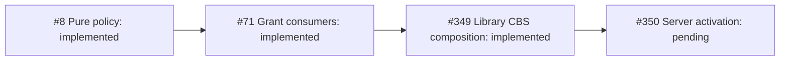

# Offline JWT Policy

`auth::JwtPolicy` is an immutable local verifier ([#8](https://github.com/DeandreT/switchyard/issues/8)),
with deliberate library CBS composition, not server CLI configuration. No network lookup,
signing API or OAuth/RFC 9068 access-token compatibility is promised.



## API

```rust
let policy = auth::JwtPolicy::from_json(configuration)?;
let requested = auth::ResourceScope::parse("amqps://tenant.example/orders")?;
let grant = policy.validate(token, &requested, now_epoch_seconds)?;
```

Time is caller-supplied unsigned epoch seconds, with zero skew and no wall-clock
lookup. The configured deployment audience is distinct from the requested scope.

## Configuration Shape

This public-modulus placeholder is intentionally invalid; replace it with a real
canonical unpadded base64url RSA modulus before loading this example.

```json
{
  "version": 1,
  "issuer": "https://issuer.example/", "audience": "urn:switchyard:tenant",
  "keys": [{"kid":"key-1","kty":"RSA","alg":"RS256","use":"sig",
            "n":"<INVALID_PUBLIC_MODULUS_PLACEHOLDER>","e":"AQAB"}],
  "bindings": [{"subject":"producer","scope":"amqps://tenant.example/orders",
                "permissions":["send"]}]
}
```

Version 1 has one exact HTTPS issuer and audience, 1-8 unique key IDs and 1-64
unique subjects. Each subject has one scope and 1-3 unique `send`/`listen`/`manage`
rights; Manage includes Send and Listen. Token role/scope claims cannot grant rights.
Scopes retain existing `ResourceScope` AMQPS hierarchy and ASCII-folding behavior.

## Accepted Profile And Bounds

Header fields are exactly `alg: RS256`, configured `kid`, and `typ: switchyard+jwt`.
Keys are odd 2048-4096-bit RSA moduli without leading zeroes, exponent 65537.
Required claims are `iss`, `sub`, `aud`, unsigned integer `iat`/`exp`; optional `nbf`
is an unsigned integer, never null. `aud` is a string or 1-8 unique strings. Issuer, subject and
audience match exactly. Lifetime is 1-3600 seconds; `nbf < exp` and validation
requires `max(iat, nbf or iat) <= now < exp`. Unknown claims grant no privileges.

Limits: config 64 KiB; token 8 KiB; decoded header/claims 2/6 KiB; JSON depth 8;
config/header/claims nodes 2048/64/256; key ID 128 bytes, subject 512 bytes,
issuer/audience/resource 2 KiB. Duplicate decoded JSON names are refused at every
depth. Configuration/header unknown fields are refused. Compact segments must be
canonical unpadded base64url; JSON itself need not be canonical. Verification uses
the original signed bytes. Errors are static; policy/key and issuer debug output
is redacted, not a claim that grant subjects/scopes are hidden.

`AccessGrant::same_principal` compares JWT issuer plus subject, or SAS/PLAIN verified
namespace host plus key name, not scope. `is_valid_at`/`allows` enforce the stored
interval even if supplied time moves backwards; SAS/PLAIN validity begins at zero.
Connection refresh replaces rights and both validity bounds only for the same
verified principal and scope; different issuers, SAS identities and scopes remain
independent. Connection validity, operation checks and link-expiry waits honor the
full interval, including its lower bound. Far-future SAS expiry waits use bounded
timers without shortening the grant interval.

## Library CBS Composition

```rust
let authentication = protocol_amqp::SharedAccessAuthentication::new(sas_policy, namespace_host)?
    .with_jwt_policy(policy);
let listener = protocol_amqp::AmqpListener::new(broker, namespace)
    .with_tls(server_tls)
    .with_shared_access_authentication(authentication);
```

The existing SAS configuration and default APIs remain SAS-only unless a JWT
policy is supplied. SASL ANONYMOUS or MSSBCBS establishes the CBS exchange; SASL
PLAIN retains its shared-access semantics. CBS `put-token` accepts exact type
`jwt` or `servicebus.windows.net:sastoken`; other spellings/types are refused.
Unconfigured JWT and failed verification return only `401 Unauthorized`, without
token, claim or verifier-error details. Unsupported types return `400`.

JWT verification is enabled per connection only after the library successfully
completes TLS on that connection's actual stream, before AMQP negotiation. The
private admission proof travels with that stream through any WebSocket upgrade.
Merely setting a TLS configuration cannot authorize a separate plaintext
connection. Configured JWT is refused over plaintext TCP and WebSockets; SAS
development fixtures remain compatible. TLS server identity must be verified by
the client; this does not add mutual TLS or authenticate the client certificate.

The CBS `name` is the requested AMQPS resource scope. It is not the configured
deployment JWT audience, and neither is the SDK's acquisition scope. Official
Azure.Messaging.ServiceBus [7.21.0](https://github.com/Azure/azure-sdk-for-net/blob/Azure.Messaging.ServiceBus_7.21.0/sdk/servicebus/Azure.Messaging.ServiceBus/src/Amqp/CbsTokenProvider.cs)
and [7.20.2](https://github.com/Azure/azure-sdk-for-net/blob/Azure.Messaging.ServiceBus_7.20.2/sdk/servicebus/Azure.Messaging.ServiceBus/src/Amqp/CbsTokenProvider.cs)
declare `jwt` for non-shared TokenCredential credentials. The 7.21.0 default token
request scope is `https://servicebus.azure.net/.default`, independent of CBS
`appliesTo`/`name`. A test credential returning this offline profile is not
certification of generic Azure/OIDC access tokens.

Verified grants enter the same connection store and operation/link consumers as
SAS. Refresh retains principal/scope isolation and the full validity interval;
failed refresh does not remove an existing grant. CBS request/reply custody still
retains and joins original started operations; retiring unstarted validation does
not publish a grant. Library composition adds no server startup flags, discovery,
signing setup or production activation. Server activation is tracked by #350.
