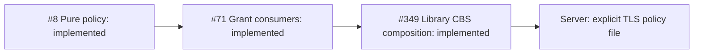

# Offline JWT Policy

`auth::JwtPolicy` is an immutable local verifier ([#8](https://github.com/DeandreT/switchyard/issues/8)),
with explicit TLS server activation and library CBS composition. No network lookup,
signing API or OAuth/RFC 9068 access-token compatibility is promised.



## API

```rust
let policy = auth::JwtPolicy::from_json(configuration)?;
let requested = auth::ResourceScope::parse("amqps://tenant.example/orders")?;
let grant = policy.validate(token, &requested, now_epoch_seconds)?;
```

Time is caller-supplied unsigned epoch seconds, with zero skew and no wall-clock
lookup. The configured deployment audience is distinct from the requested scope.

## Configuration Shape

This public-modulus placeholder is intentionally invalid; replace it with a real
canonical unpadded base64url RSA modulus before loading this example.

```json
{
  "version": 1,
  "issuer": "https://issuer.example/", "audience": "urn:switchyard:tenant",
  "keys": [{"kid":"key-1","kty":"RSA","alg":"RS256","use":"sig",
            "n":"<INVALID_PUBLIC_MODULUS_PLACEHOLDER>","e":"AQAB"}],
  "bindings": [{"subject":"producer","scope":"amqps://tenant.example/orders",
                "permissions":["send"]}]
}
```

Version 1 has one exact HTTPS issuer and audience, 1-8 unique key IDs and 1-64
unique subjects. Each subject has one scope and 1-3 unique `send`/`listen`/`manage`
rights; Manage includes Send and Listen. Token role/scope claims cannot grant rights.
Scopes retain existing `ResourceScope` AMQPS hierarchy and ASCII-folding behavior.

## Accepted Profile And Bounds

Header fields are exactly `alg: RS256`, configured `kid`, and `typ: switchyard+jwt`.
Keys are odd 2048-4096-bit RSA moduli without leading zeroes, exponent 65537.
Required claims are `iss`, `sub`, `aud`, unsigned integer `iat`/`exp`; optional `nbf`
is an unsigned integer, never null. `aud` is a string or 1-8 unique strings. Issuer, subject and
audience match exactly. Lifetime is 1-3600 seconds; `nbf < exp` and validation
requires `max(iat, nbf or iat) <= now < exp`. Unknown claims grant no privileges.

Limits: config 64 KiB; token 8 KiB; decoded header/claims 2/6 KiB; JSON depth 8;
config/header/claims nodes 2048/64/256; key ID 128 bytes, subject 512 bytes,
issuer/audience/resource 2 KiB. Duplicate decoded JSON names are refused at every
depth. Configuration/header unknown fields are refused. Compact segments must be
canonical unpadded base64url; JSON itself need not be canonical. Verification uses
the original signed bytes. Errors are static; policy/key and issuer debug output
is redacted, not a claim that grant subjects/scopes are hidden.

`AccessGrant::same_principal` compares JWT issuer plus subject, or SAS/PLAIN verified
namespace host plus key name, not scope. `is_valid_at`/`allows` enforce the stored
interval even if supplied time moves backwards; SAS/PLAIN validity begins at zero.
Connection refresh replaces rights and both validity bounds only for the same
verified principal and scope; different issuers, SAS identities and scopes remain
independent. Connection validity, operation checks and link-expiry waits honor the
full interval, including its lower bound. Far-future SAS expiry waits use bounded
timers without shortening the grant interval.

## Library CBS Composition

```rust
let authentication = protocol_amqp::SharedAccessAuthentication::new(sas_policy, namespace_host)?
    .with_jwt_policy(policy);
let listener = protocol_amqp::AmqpListener::new(broker, namespace)
    .with_tls(server_tls)
    .with_shared_access_authentication(authentication);
```

The existing SAS configuration and default APIs remain SAS-only unless a JWT
policy is supplied. SASL ANONYMOUS or MSSBCBS establishes the CBS exchange; SASL
PLAIN retains its shared-access semantics. CBS `put-token` accepts exact type
`jwt` or `servicebus.windows.net:sastoken`; other spellings/types are refused.
Unconfigured JWT and failed verification return only `401 Unauthorized`, without
token, claim or verifier-error details. Unsupported types return `400`.

JWT verification is enabled per connection only after the library successfully
completes TLS on that connection's actual stream, before AMQP negotiation. The
private admission proof travels with that stream through any WebSocket upgrade.
Merely setting a TLS configuration cannot authorize a separate plaintext
connection. Configured JWT is refused over plaintext TCP and WebSockets; SAS
development fixtures remain compatible. TLS server identity must be verified by
the client; this does not add mutual TLS or authenticate the client certificate.

The CBS `name` is the requested AMQPS resource scope. It is not the configured
deployment JWT audience, and neither is the SDK's acquisition scope. Official
Azure.Messaging.ServiceBus [7.21.0](https://github.com/Azure/azure-sdk-for-net/blob/Azure.Messaging.ServiceBus_7.21.0/sdk/servicebus/Azure.Messaging.ServiceBus/src/Amqp/CbsTokenProvider.cs)
and [7.20.2](https://github.com/Azure/azure-sdk-for-net/blob/Azure.Messaging.ServiceBus_7.20.2/sdk/servicebus/Azure.Messaging.ServiceBus/src/Amqp/CbsTokenProvider.cs)
declare `jwt` for non-shared TokenCredential credentials. The 7.21.0 default token
request scope is `https://servicebus.azure.net/.default`, independent of CBS
`appliesTo`/`name`. A test credential returning this offline profile is not
certification of generic Azure/OIDC access tokens.

Verified grants enter the same connection store and operation/link consumers as
SAS. Refresh retains principal/scope isolation and the full validity interval;
failed refresh does not remove an existing grant. CBS request/reply custody still
retains and joins original started operations; retiring unstarted validation does
not publish a grant.

## Server Activation

`--jwt-policy-file PATH` explicitly enables this profile on a TLS AMQP TCP or WSS
listener. See the [server configuration](../crates/server/README.md#offline-amqp-jwt).
The bounded policy load and TLS/configuration checks precede durable state open.
The AMQP policy is independent of native administration. JWT-only and combined
SAS/JWT configurations are supported; incomplete SAS configuration still refuses.
This adds no discovery, signing setup, generic Azure-token compatibility or
production activation. The existing production quorum guard remains closed.

## Bounded Discovery Library

`auth::oidc::OidcVerifier` adds explicit discovery and signing-key rotation for
the **same Switchyard token profile**, not generic Azure OAuth/OIDC access-token
compatibility. This is a separate library API; it does not activate online
verification in CBS, the server, administration or command execution. The
production quorum guard remains closed. Issuer infrastructure, signing setup
and production activation are separate deployment work.

Construct a `JwtPolicy` from the version-1 local configuration above, then create
two `PinnedEndpoint`s: the issuer with `/.well-known/openid-configuration`
appended (after removing trailing `/`), and an exact approved JWKS URL on that
issuer's origin (same HTTPS scheme, host and effective port). Supply both to
`HttpsTransport::new` with 1-8 explicit DER root certificates (64 KiB total), then
pass that transport, the local policy and `CachePolicy` to `OidcVerifier::new`.
The policy supplies the exact issuer, audience and subject/scope/permission
bindings. Its offline keys **do not bootstrap** the discovery cache.

For example, inside a Tokio runtime with locally loaded `configuration` and
`root_der` (DER certificate bytes):

```rust
use auth::oidc::{CachePolicy, HttpsTransport, OidcVerifier, PinnedEndpoint};
use rustls::pki_types::CertificateDer;

let local = auth::JwtPolicy::from_json(configuration)?;
let discovery = PinnedEndpoint::new(
    "https://issuer.example/.well-known/openid-configuration",
    approved_discovery_ip,
)?;
let jwks = PinnedEndpoint::new("https://issuer.example/keys", approved_jwks_ip)?;
let transport = HttpsTransport::new(discovery, jwks, vec![CertificateDer::from(root_der)])?;
let verifier = OidcVerifier::new(local, transport, CachePolicy::default())?;
verifier.refresh().await?; // Maintenance path, not called in response to a token.
let grant = verifier.validate(token, &requested_scope, now_epoch_seconds)?;
```

The local policy's issuer must be exactly `https://issuer.example/` for this
example; the approved IPs must pass the production public-address restrictions.

Each endpoint also requires one operator-approved **public dial IP**. This API
deliberately performs zero DNS queries: no system resolver, resolver callback,
blocking DNS task or unbounded resolver cancellation exists. DNS answers cannot
rebind the socket; callers must update local configuration when an approved IP
changes. Host/SNI and certificate verification still use the pinned URL hostname,
not that IP. Operators should provision approved IPs through their trusted local
configuration process, not token claims, `peerHost` or discovery responses.
Literal IP URLs must match their dial IP. Production rejects private, loopback,
link-local, multicast, unspecified, reserved IPv4, mapped/compatible IPv6,
transition-address and conservative special-purpose IPv6 ranges. The local TLS
test fixture's exact IPv4 loopback exception exists only under `cfg(test)`, not
as a production setting or feature.

TLS validates the chain and hostname against only the explicit roots; it never
uses machine trust, client certificates, credential callbacks, cookies, ambient
credentials or proxy environment variables. Redirects are refused, not followed.
There is no cross-origin JWKS option. Discovery must return the exact issuer
string and exact configured JWKS URL. Unknown discovery metadata is bounded and
ignored, never used to expand network authority. Discovery URLs and JWKS URLs
are at most 2 KiB, HTTPS only, without credentials, query or fragment.

Call `refresh().await` from an application-controlled maintenance path, then use
`validate(token, requested_scope, now_epoch_seconds)` for new grants. Validation
is synchronous and performs no I/O. Tokens, including unknown `kid`s and refused
`jku`/`x5u` headers, never schedule refreshes. All clones share one cache and one
refresh budget: one admitted refresh, no queued refreshes, at most two sequential
HTTPS requests and one socket at a time. A second concurrent refresh returns
`Busy`; an early refresh returns `Backoff`. Callers must retain/join any tasks
they themselves spawn. The library creates no background workers, connection
drivers, resolver jobs or retained-task list. Hyper's connection driver and
exchange are polled in the original refresh future; cancellation drops both and
closes the socket, rather than detaching cleanup. No library shutdown/drain task
is needed.

### Freshness, Failure And Removal

The cache starts unavailable. Default maximum freshness is 300 seconds, successful
refresh interval 60 seconds, failure backoff 10 seconds and whole-refresh deadline
5 seconds. Local hard ranges are respectively 1-3600 seconds, 1 second through
maximum freshness, 1-300 seconds and 10 milliseconds through 30 seconds. The one
deadline covers dial, TLS, both HTTP responses, parsing and publication; it is not
reset at each stage. Cancelled refreshes retain a conservative admission delay
through their original deadline plus failure backoff. Successful completion uses
the refresh interval; other completion uses failure backoff.

Freshness and backoff use monotonic Tokio time, independently of caller-supplied
JWT epoch time. Every verification, including calls through old verifier clones,
checks freshness before and after bounded signature work under the cache lock.
No immutable `JwtPolicy` snapshot is exposed by this API. At age **greater than
or equal to** maximum freshness, new verification fails closed. An unavailable
issuer, timeout, malformed document or invalid key retains the old set only until
its original freshness deadline; failures never extend freshness. There is no
stale-while-error or token-introspection fallback.
Issuer HTTP cache headers cannot extend or override the locally configured age;
there is no conditional-request/304 path that silently renews an old key set.

A successful refresh atomically replaces the entire key set. Keys removed in that
set cannot verify subsequent requests through any verifier clone; an empty valid
`keys` array closes all keys. Partial/invalid sets never publish. JWKS accepts
only the offline public-key fields/profile above and at most eight unique keys;
private key fields, unsupported algorithms, extra JWK members and duplicate JSON
names are refused. Providers emitting other standard JWK metadata need a separately
designed profile, not implicit relaxation of the local verifier. Discovery and
JWKS each have a 64 KiB body bound, JSON depth 8 and 2048 value nodes, checked
before publication. HTTP uses maintained Hyper/rustls parsers, at most 32 headers
and an 8 KiB read/header buffer. Only successful JSON responses without content
encoding are accepted; chunked and lengthless bodies are counted incrementally,
oversized declared bodies and trailers are refused. Cache growth is bounded to
the local policy and one published set plus one bounded in-progress replacement.
Errors and debug output contain static categories, not URLs, queries, tokens,
claims, keys or underlying TLS/network diagnostics. The verifier emits no logs.

Key removal and cache expiry prevent **new verification**, not revocation of an
already returned `AccessGrant`. Existing consumers retain their grant until its
stored token expiry or their explicit connection/grant cleanup. Refresh does not
shorten those grants, persist revocations or notify consumers. Expiry still needs
the consumers' existing interval checks; removal does not retroactively undo an
operation already authorized. The legacy `JwtPolicy` API intentionally remains
an immutable offline contract: callers retaining an independently loaded offline
policy can still use its keys. Online consumers must use `OidcVerifier::validate`,
not substitute an offline snapshot or fallback when discovery is unavailable.
