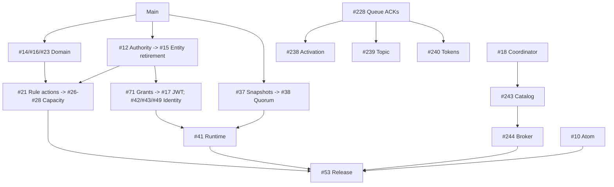
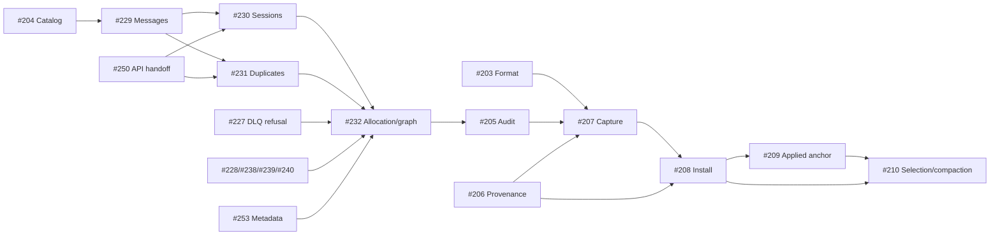

# Completion Roadmap

Pre-alpha: only verified, merged `main` is complete.
[Issues](https://github.com/DeandreT/switchyard/issues) own scope;
[compatibility](compatibility.md) records guarantees.

## Main Progress

- [x] AMQP/SASL/CBS; settlement, DLQ, deferral, peek, sessions, scheduling, queue duplicates.
- [x] Actionless topics/rules, bounded SQL filters and filter-error routing,
  AMQP rule management, bounded topology and selected profile integrity.
- [x] Memory/Fjall format-2 and opt-in journal/indexed apply/local replay.
- [x] Local authority, JWT/SQL kernels and native/link/session/connection custody.
- [x] Source-bound builds and pinned Memory SDK TCP/WSS gates.
- [x] Typed retained content: store format 3, proposal V4 sends and copy-local patches.
- [x] Offline snapshot capture, install, anchors and journal compaction.
- [x] Ordered, budgeted process shutdown through retained listener/protocol tasks,
  timer and broker; cancellation and committed-state reopen controls.
- [x] Explicit queue/topic capacity profiles; finite sizes are recorded metadata,
  not retained-byte admission or usage accounting.
- [ ] Remaining semantics, administration and conserved physical-byte capacity.
- [ ] Full recovery, quorum, multi-tenant security and measured release.

## Next Main Increments

#7 and its listener/admission/process children are complete. #248 WSS fixture
wire bounds and the namespace administration core (#18) are also complete.
Process shutdown is ordered and budgeted; joins have no Close/latency guarantee.
Reference branches are not main evidence; #15 is entity retirement. #255's qualified history audit is closed.

## Snapshot Recovery

#36 local replay and #37 offline install, anchors and compaction are merged. Live
recovery waits on quorum (#38) and runtime activation (#41).

- [x] #203 Record format.
- [x] #204 Catalog validation (partial).
- [x] #206 Backend provenance.
- [x] #205 State audit.
- [x] #207 Coherent capture.
- [x] #208 Offline atomic install.
- [x] #209 Applied-safe anchor.
- [x] #210 Selection/compaction.

#250 API/#253 metadata handoffs are sealed. Allocator publication is not
full-state health.

Partial validation is not full-state health or install authority. Capture needs
the complete image; install needs all-writer exclusivity. Prune at applied A,
not committed C; counters are not byte quotas.

## Parallel Pickup

Assign before coding. Serialize shared files and two-job builds; merge focused
PRs in dependency order ([workflow](../CONTRIBUTING.md)). Ready is not evidence.

| Lane | Pickup / overlap |
| --- | --- |
| Snapshots | #37 offline children are complete; live recovery follows #38/#41. |
| Domain | #14, #16, #20, #22 and #23 are complete. Finite admission remains #27; SQL actions remain #21. |
| Admin | #18, #243, #244 and #328 are complete; TLS listener #329 and CLI #330 remain in #19. |
| Allocators | [#228](https://github.com/DeandreT/switchyard/issues/228), #238 ([PR258](https://github.com/DeandreT/switchyard/pull/258)), #239 ([PR264](https://github.com/DeandreT/switchyard/pull/264)) and #240 ([PR263](https://github.com/DeandreT/switchyard/pull/263)) and #232's allocation/graph composition verified. |
| SDK/security | #7 and #71 grant consumers are complete; JWT activation #17 and durable SDK matrix #101 remain pending. |
| Native Flow | Outgoing session windows #331 are complete; incoming conservation #332, receiver refill #69 and Flow echo #77 remain pending. |

Shared: #243 keys.rs (released by #229); machine.rs overlaps #240. #244 serializes broker
ownership. Allocator error/condition/indexed edits serialize; #239 also
coordinates #14/#23.

SDK evidence is experimental current/previous Memory, not latest/durable.
Production still refuses; quorum/recovery/runtime remain pending.
#234 and [#236](https://github.com/DeandreT/switchyard/issues/236) are closed/verified; PR246 split the lifecycle reference.

## Milestones

| Gate | Remaining work |
| --- | --- |
| [M1](https://github.com/DeandreT/switchyard/milestone/1) | Lifecycle, authority, profiles, entity retirement, typed content. |
| [M2](https://github.com/DeandreT/switchyard/milestone/2) | SDK/admin semantics, sustained Flow, capacity, same-group transactions. |
| [M3](https://github.com/DeandreT/switchyard/milestone/3) | Recovery/quorum, identity/fairness, encrypted audit/backup, measured release. |

## Completion Checks

- [ ] **Foundation:** live owner health, retained-authority fencing, bounded lifecycle
  and format refusal/reopen gates are merged; no stale path can mutate a new entity.
- [ ] **Compatibility:** declared current/previous SDK and administration clients
  exercise supported semantics, rules, sessions, TTL, modes and transactions;
  remaining deviations are explicit and unsupported requests refuse.
- [ ] **Capacity:** physical-byte conservation covers every queue/topic lifecycle
  and copy/error route; no public finite profile exists without its ledger.
- [ ] **Production:** all proposals/timers/consistent reads use real quorum routing,
  with no local fallback; quotas, identity, KMS encryption and committed audit pass.
- [ ] **Recovery:** full-state restart/install/compaction, partitions, key rotation,
  corrupt-backup refusal and empty-cluster restore pass under faults.
- [ ] **Release:** signed Linux x64/arm64 artifacts/SBOMs plus published three-replica,
  encrypted/audited 100k 1KiB messages/s and under-20ms p99 evidence; 5TiB soak
  includes compaction, failover, backup and restore on declared hardware.

[#53](https://github.com/DeandreT/switchyard/issues/53) reaches every lane. Executed
evidence, not code presence or skipped tests, closes gates; 1.0 stays reserved.
[Architecture](../ARCHITECTURE.md) retains non-goals: Premium, cross-group atomic
transactions, geo replication and regulatory certification.
