# SDK Gates

The .NET TCP/WSS workflows are experimental Memory/Fjall data-plane gates.
Selectors are fixed: `declared-current` is ServiceBus 7.21.0 / Core 1.62.0;
`previous` is 7.20.2 / 1.60.0. Neither means latest. Exact ranges, locked graphs
and selected runtime DLL approvals are checked in under `crates/conformance/pins`.
Ordinary workspace tests ignore these workflows and the opt-in controls.
Selecting one requires
Linux, .NET 10 and NuGet restore; missing prerequisites fail rather than skip.

The separate `declared_current_memory_tcp_sustained_send` selector in
`amqp_dotnet_current` sends 2,305 individual deliveries through one retained SDK
sender with retries disabled. It uses the same pinned assets, loaded-assembly and
original-child custody checks as the TCP workflows. After the original protocol
and timer joins, native checks verify every ordered stored body and an empty
queue. This is an additional focused gate, not a ninth matrix cell. Like the
existing TCP fixture, its certificate callback bypasses validation only for the
test endpoint; it neither changes machine trust nor certifies production TLS.

The four exact batch checks accumulate arrival-order short batches: the
[SDK receive contract](https://learn.microsoft.com/en-us/dotnet/api/azure.messaging.servicebus.servicebusreceiver.receivemessagesasync)
does not promise `maxMessages` results, even when available. Each check requests
only its remainder under one monotonic 10s budget and linked cancellation.
Empty returns pause up to 100ms; 100 total empty returns or budget exhaustion
diagnose a partial result, which still fails the unchanged exact assertions.
Over-return and late full completion fail; caller/unrelated cancellation
propagates. Nothing is filtered, reordered, reread or settled by the helper.
Original fetch tasks are directly awaited: cancellation cooperation is required,
not a finite-progress promise for uncooperative delegates. Pins, custody and
parent deadlines are unchanged.

Scheduled-topic checks separate the intentional future enqueue interval from
the positive receive window. Negative receives still check non-delivery before
the due time; the fixture then waits for that same real due time, without moving
the broker clock. Each subscription collects singular receives under one 12s
monotonic budget using the same bounded accumulator. Empty short returns do not
mean a missing publication; exact IDs, order-independent expected sets, counts,
metadata, cancellation and post-completion empty checks still apply. No SDK
operation/disposal timeout or outer child deadline is increased.

```sh
cargo test --locked -p server --test sdk_child_custody -j2
cargo test --locked -p server --test sdk_pin_controls -j2 -- --include-ignored --nocapture
cargo test --locked -p server --test amqp_dotnet_current -j2 -- --ignored --nocapture --test-threads=1
cargo test --locked -p server --test amqp_dotnet_websockets -j2 -- --ignored --nocapture --test-threads=1
python3 -m unittest discover -s crates/conformance/tests
# Run all eight, retaining each original gate log and a results.json summary;
# a failed cell does not suppress later cells. Use a new external directory.
python3 crates/conformance/run-sdk-matrix.py --output /path/to/new-evidence
# Or select individual cells; every other SDK gate remains ignored:
python3 crates/conformance/run-sdk-matrix.py --output /path/to/another-evidence --cell previous_fjall_wss
```

| Exact Rust selector | Test target |
| --- | --- |
| `declared_current_memory_tcp` | `amqp_dotnet_current` |
| `declared_current_fjall_tcp` | `amqp_dotnet_current` |
| `previous_memory_tcp` | `amqp_dotnet_current` |
| `previous_fjall_tcp` | `amqp_dotnet_current` |
| `declared_current_memory_wss` | `amqp_dotnet_websockets` |
| `declared_current_fjall_wss` | `amqp_dotnet_websockets` |
| `previous_memory_wss` | `amqp_dotnet_websockets` |
| `previous_fjall_wss` | `amqp_dotnet_websockets` |

These are not eight identical scenarios: TCP retains DLQ, renewal, abandonment,
property updates and session-state workflows; WSS retains its tunnel-specific
batch/deferred/schedule/topic/session-attach workflows. Both retain SQL and
correlation-rule conformance. Each cell reports its pin/backend/transport,
approved resolved packages, exact loaded assembly identity/path/hash, bounded
original-child output and transport-specific native empty-queue postconditions.
Fjall cells retire/finish the retained listener service (joining its original
connection family), signal/join the owned timer, explicitly join the broker by
dropping it, capture a quiescent logical snapshot and drop the retained store.
Only then do they reopen the same path and compare logical records, not files.
Cooperative resource joins are not a universal finite-progress guarantee.

The runner executes serially, fails a zero-test match, and returns nonzero if any
selected cell fails. Missing prerequisites fail selected gates; there are no
SDK/backend/transport fallbacks. Non-Linux platforms are unsupported by the child
custody harness, including WSS trust setup: selecting a cell there fails rather
than claiming a pass or silently skipping. `--jobs 1` reduces Cargo workers;
`--cargo-wrapper /path/to/lease.sh` uses a Bash build-lease launcher. Set
`CARGO_TARGET_DIR`/`CARGO_BUILD_BUILD_DIR` to the approved external target. Choose
external evidence storage with sufficient space: the runner sets `TMPDIR` below
it, so isolated project/bin/obj, NuGet caches and CLI homes also stay there.
Isolated SDK commands set `DOTNET_ADD_GLOBAL_TOOLS_TO_PATH=false`.

## Bounded Diagnosis

`SWITCHYARD_SDK_DIAGNOSTICS=1` records wall/elapsed timestamps, SDK events including
authorization expiry (never SAS tokens), native command outcomes, and read-only
message inventories before retirement and after original protocol/timer joins.
Native observations cap at 1200 lines/2048 characters and child observations at
600 lines/1536 detail characters; the existing child stream ceilings still apply.
The child's return/error is observed before fixture retirement, so a disposal
timeout must not be attributed to teardown merely because cleanup follows it.

Explicit latency probes are not qualifications: `SWITCHYARD_SDK_TEST_TIMER_LAG_MS`
(1–5000ms) withholds the owned timer's sweeps until the scheduled-topic due time
plus that lag, without changing the broker clock. The timer probe recognizes both
legacy and current AMQP sends. `SWITCHYARD_SDK_DIAG_DELAY_RECEIVE`
(`scheduled-topic` or `empty-rule`) plus `SWITCHYARD_SDK_DIAG_DELAY_MS` (1–30000ms)
holds one original receiving command future after the selected fixture frontier.
Both probes keep original resource custody and emit `NOT-QUALIFICATION` markers.
The matrix runner refuses their environment variables; use an exact Cargo test
only when deliberately diagnosing, and retain the attempt separately from matrix
results. An empty SDK receive alone does not prove missing native records; a
disposal timeout alone does not prove a pin regression or a protocol deadlock.

Standalone fake-receiver controls use .NET 10 without NuGet packages; they are
separate from ordinary Rust CI and do not certify SDK/broker behavior:

```sh
DOTNET_PROCESSOR_COUNT=2 dotnet run --project crates/conformance/batch-receive-controls/Switchyard.Conformance.BatchReceiveControls.csproj --configuration Release
```

## Custody Contract

```mermaid
flowchart LR
    Pins["Exact selector + locked graph + DLL approvals"] --> Build["Isolated restore + fresh project/bin/obj"]
    Build --> Assets["Resolved runtime assets + package/output hashes"]
    Assets --> Files["Pre-hashed absolute DLLs"]
    Files --> Start["Original child: nonce + loaded identities"]
    Start --> Work["Unchanged workflow + async disposal"]
    Work --> Complete["Post-disposal completion record"]
    Complete --> Reap["Group termination before original leader reap"]
    Reap --> Verify["Parent matches records + post-hashes"]
```



| Boundary | Limit or evidence |
| --- | --- |
| Restore + build/run | Combined 300s restore/build and separate 180s run deadlines; .NET processor count/MSBuild workers set to two |
| Output | Owned nonblocking stdout/stderr, each capped at 1 MiB; records at 16 KiB |
| Identity | Entry, ServiceBus and Core: FullName, informational version, actual Location and SHA256; nonce-bound start/completion must match launched files |
| Artifacts | 64 MiB/file ceiling; invocation-owned project/output, package, HTTP/scratch/plugin caches and CLI home; no global package fallback |
| Pins | Wrong selector/range/graph, ambiguous runtime assets, mixed output and poisoned cache/output bytes refuse before launch |
| Cleanup | Original child retained; non-reaping leader check, group kill before wait; failed wait retries never signal a possibly reused PID |
| Controls | Original-PID retry, exact leader reap and captured descendant pidfd exit; watchdog intervention fails, not certifies, cleanup |

Completion is emitted only after the original workflow's async disposals return.
Locked restore fixes the graph; byte custody covers the entry and selected
ServiceBus/Core DLLs, not every loaded dependency or independent PE metadata.
Controls require Linux pidfd support and prove descendant exit,
not descendant reap. Escaped groups and uninterruptible kernel waits are excluded;
synchronous cleanup is not a sandbox or universal finite-progress guarantee.

TCP retains its permissive test certificate callback; WSS retains child-scoped
`SSL_CERT_FILE` trust. Neither certifies production trust, administration or
universal task-tree shutdown or behavior under every injected failure. See
[compatibility](compatibility.md).
